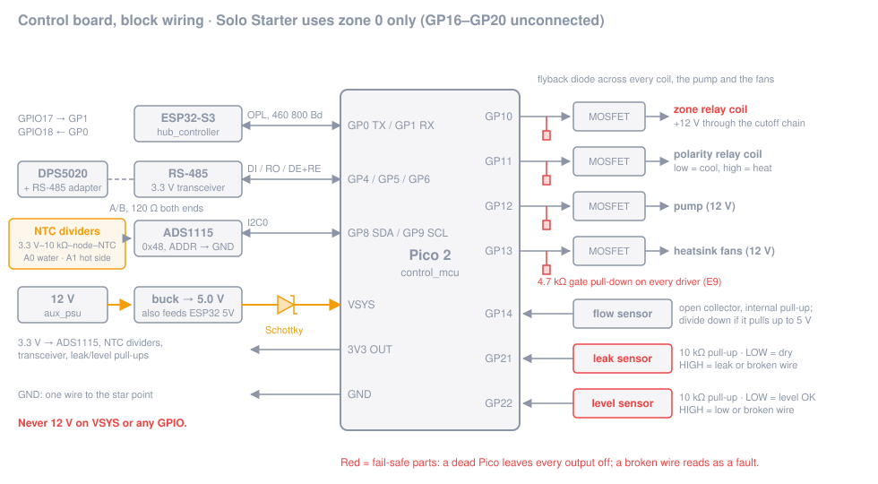

# Step 2: Control board

**Goal:** a Pico 2 on a perfboard that reads two temperatures, a flow sensor, a leak sensor and a level sensor,
talks Modbus (RS-485) to the DPS5020 and OPL (UART) to the hub, and drives four outputs (zone relay, polarity relay,
pump, fans) that are **off whenever the Pico is not actively driving them**.

**Time:** 5–7 h.

**Or use the carrier PCB:** the [Tier 0 carrier PCB](../../hardware/pcb/carrier/README.md) replaces the perfboard
and breakouts of this step (same pin map, pull-downs, fail-safe inputs and CUTOFF LOOP). Rev A is untested: review
it before ordering, and still do the checkpoint below.

## Parts

| Role / item | Qty | Notes |
|---|---|---|
| `control_mcu` (Raspberry Pi Pico 2) | 1 | with header pins |
| `hub_controller` (ESP32-S3-DevKitC-1) | 1 | wired in this step, flashed in [step 6](06-software.md) |
| `temp_sensors`: inline G1/4 10k NTC (water) + a 10k NTC for the heatsink base | 1 + 1 | |
| `leak_sensor` | 1 | needs an output that is **closed to GND only while powered and dry** (see below) |
| `temp_sensors`: ADS1115 breakout, 3.3 V | 1 | address 0x48 (ADDR pin to GND); the firmware reads only this one |
| `temp_sensors`: 10 kΩ 0.1 % resistors | 2 | NTC divider top resistors |
| 3.3 V RS-485 transceiver *(no role yet)* | 1 | Pico side; with DE and /RE pins, or an auto-direction module (then GP6 stays unused) |
| TTL-to-RS-485 adapter *(no role yet)* | 1 | DPS5020 side ([step 3](03-power-path.md)) |
| Logic-level N-channel MOSFETs (fully on at V_GS = 3.3 V, ≥ 2 A) *(no role yet)* | 4 | zone relay, polarity relay(s), pump, fans; a 4-channel 3.3 V MOSFET module works too (add the pull-downs at its inputs, check for flyback diodes) |
| Flyback diodes (1N4007 / 1N5408 class) *(no role yet)* | 4 | one across each relay coil, pump and fan group |
| Gate resistors 220 Ω, pull-down resistors 4.7 kΩ *(no role yet)* | 4 + 4 | see the E9 note below |
| 10 kΩ pull-up resistors *(no role yet)* | 2 | leak and level inputs |
| 12 V → 5 V buck module, ≥ 1 A *(no role yet)* | 1 | powers Pico and ESP32 |
| Schottky diode (1N5819 class) *(no role yet)* | 1 | Pico VSYS back-feed protection |
| Perfboard, pin headers, screw terminals, 0.25–0.5 mm² wire | | |

The reservoir level sensor belongs to the `reservoir` role and the flow sensor to `flow_sensor`; you wire their
signal inputs here and mount them in [step 5](05-water-loop.md).

## Pin map

From [`board.rs`](../../firmware/obc-pico2/src/board.rs) and [`WIRING.md`](../../hardware/WIRING.md). A Solo build
uses only the zone 0 pins; **leave GP16–GP20 unconnected.**

| Pico 2 pin | Function | Connects to |
|---|---|---|
| GP0 / GP1 | UART0 TX / RX, OPL 460 800 Bd | ESP32-S3 GPIO18 (RX) / GPIO17 (TX), crossed over |
| GP4 / GP5 | UART1 TX / RX, Modbus 9 600 Bd | RS-485 transceiver DI / RO |
| GP6 | RS-485 DE + /RE (high = transmit) | transceiver DE and /RE tied together |
| GP8 / GP9 | I2C0 SDA / SCL | ADS1115 SDA / SCL |
| GP10 | zone relay, zone 0 | MOSFET gate (relay coil goes through the cutoff chain) |
| GP11 | polarity relay, zone 0 (low = cool, high = heat) | MOSFET gate |
| GP12 | pump on, zone 0 | MOSFET gate |
| GP13 | fans on, zone 0 | MOSFET gate |
| GP14 | flow sensor pulses, zone 0 | sensor output (open collector; the firmware enables the internal pull-up) |
| GP21 | leak sensor: **LOW = dry**; HIGH = leak or broken wire | 10 kΩ pull-up to 3.3 V |
| GP22 | water level: **LOW = OK**; HIGH = low or broken wire | 10 kΩ pull-up to 3.3 V |

ADS1115 channels: **A0** = water NTC (inline, return line), **A1** = hot-side NTC (heatsink base). A2/A3 are zone 1
and stay unconnected.

## Steps

### 2.1 Power and ground

1. Mount the 12 V → 5 V buck module. Set its output to 5.0 V **before** you connect anything to it.
2. Feed the Pico through the Schottky diode into **VSYS** (pin 39): buck 5 V → diode anode, diode cathode → VSYS.
   The diode stops the 5 V rail from back-feeding into your computer when USB is plugged in.
3. Feed the ESP32-S3 from the same 5 V rail on its **5V** pin. Don't plug the ESP32's USB in while the 5 V rail is
   on unless you have checked that your board protects against back-feed.
4. Plan **one star ground point** near the DPS5020 ([step 3](03-power-path.md)): 24 V negative, 12 V negative and
   the control board GND meet there and only there. Run one solid GND wire from the board to the star point.

⚠️ **Never put 12 V on VSYS or on any Pico pin.** The Pico takes 1.8–5.5 V on VSYS; the GPIOs are 3.3 V.

### 2.2 ADS1115 and NTC dividers

1. ADS1115: VDD → Pico **3V3 OUT** (pin 36), GND → GND, SDA → GP8, SCL → GP9, ADDR → GND (address 0x48).
   Most breakouts already have I2C pull-ups to VDD; if yours doesn't, add 4.7 kΩ from SDA and SCL to 3.3 V.
2. For each NTC build a divider: **3.3 V → 10 kΩ 0.1 % → node → NTC → GND**. The node goes to the ADS input
   (A0 water, A1 hot side). This orientation matters: the firmware computes R_NTC = 10 kΩ · V / (3.3 V − V).
3. Use a two-wire screw terminal for each NTC so you can swap sensors.

### 2.3 RS-485 to the DPS5020

1. Transceiver VCC → 3.3 V, GND → GND, DI → GP4, RO → GP5, DE and /RE tied together → GP6. (Auto-direction modules
   have no DE pin: TX → GP4, RX → GP5, GP6 unconnected; the firmware still toggles it, harmlessly.)
2. Bring A and B out to a screw terminal. The bus goes to the TTL-to-RS-485 adapter at the DPS in step 3.
3. Termination: 120 Ω between A and B at **both ends** of the bus (many adapter boards have a jumper or a fitted
   resistor; check, don't double it).

### 2.4 Hub UART

ESP32-S3 **GPIO17 (TX) → Pico GP1**, **GPIO18 (RX) ← Pico GP0**, plus a GND wire alongside. Keep these wires short
(≤ 20 cm); the link runs at 460 800 Bd.

### 2.5 Output drivers (fail-off)

Build four identical low-side switches, one each for GP10 (zone relay), GP11 (polarity relay), GP12 (pump),
GP13 (fans):

1. MOSFET source → GND. Drain → the negative side of the load. The load's positive side goes to +12 V
   (for the zone relay: +12 V **through the cutoff chain**, see [step 3](03-power-path.md)).
2. Gate ← GPIO through a 220 Ω resistor.
3. **Pull-down: gate → GND, 4.7 kΩ**, mounted right at the MOSFET.
4. Flyback diode across every inductive load (each relay coil, the pump, the fan group): cathode to the +12 V side.

⚠️ **Why external pull-downs (RP2350 erratum E9):** an RP2350 that is in reset, unflashed or crashed must leave every
driver off. The RP2350's internal pull-downs can't be relied on for this (erratum E9), and the erratum's workaround
needs an external pull-down of **8.2 kΩ or less**. The project uses **4.7 kΩ** (`WIRING.md`, `board.rs`). The
checkpoint below verifies it on your board.

### 2.6 Fail-safe inputs: leak and level

Both inputs are wired so that **a broken wire reads as a fault**:

1. 10 kΩ pull-up from GP21 to 3.3 V, and from GP22 to 3.3 V.
2. The sensor must **pull the pin to GND only in the good state** (dry / level OK). Leak, low water, an unplugged
   connector, a cut wire or an unpowered sensor all leave the pin HIGH, and the firmware raises `LEAK` (latching) or
   `LOW_WATER`.
3. Leak modules with a relay output (`leak_sensor` examples): use the contact that is **closed only while the module is
   powered and dry**. On modules whose relay is energized in the healthy state that is the NO contact; check yours with
   a multimeter (dry → continuity; wet sensing cable → open; module unplugged → open). Wire one side of that contact to
   GP21, the other to GND.
4. Level sensor: if its output is HIGH when water is present, add an NPN inverter *at the Pico end*
   (sensor output → 10 kΩ → NPN base, emitter → GND, collector → GP22). A broken sensor wire then turns the NPN off and
   GP22 reads HIGH = fault, which keeps the fail-safe property. Some capacitive level sensors drive their **supply
   voltage** on the output (the one on the shopping list may): power it from 5 V, not 12 V, and measure the output in
   both states before you connect it. The inverter also keeps a 5 V output away from the GPIO.

⚠️ Never feed a 12 V signal into a GPIO. If a sensor module only offers a 12 V output, use a relay contact or an
optocoupler.

### 2.7 Flow sensor input

1. Flow sensor signal → GP14. The firmware turns on the internal pull-up, so an open-collector output works directly.
2. Many hall flow sensors run on 5 V and pull their output up to 5 V internally. Power the sensor, leave GP14
   disconnected, and measure the signal while you blow gently through it: if it goes above 3.3 V, add a divider
   (10 kΩ series, 20 kΩ to GND) in front of GP14.

## ✅ Checkpoint (Pico not yet flashed)

Do these with the 12 V brick on, the 24 V brick **unplugged**, and nothing connected to the relay/pump/fan outputs
except what this step built.

- [ ] 5 V rail: **4.9–5.2 V**. Pico 3V3 OUT: **3.25–3.35 V**.
- [ ] Resistance gate → GND on each of the four MOSFETs (power off): **≈ 4.7 kΩ** (slightly less with the Pico fitted).
- [ ] Pico **held in reset** (connect RUN, pin 30, to GND) and also with the Pico unflashed: every gate measures
      **< 0.3 V**, and nothing clicks or spins.
- [ ] Touch a gate briefly to 3.3 V through a 1 kΩ resistor: the polarity relay clicks; release: it drops.
      Repeat for pump and fan outputs (with pump/fans connected, the pump must have water in it or stay off < 1 s).
- [ ] NTC node voltages with the sensors at room temperature: **≈ 1.8 V at 20 °C, ≈ 1.65 V at 25 °C**
      (generic 10k NTC, β 3435). Unplugged sensor: **≈ 3.3 V**. Shorted sensor: **≈ 0 V**. The firmware rejects both
      as `SENSOR_INVALID`.
- [ ] GP21 with the leak sensor dry and powered: **< 0.3 V**; leak sensor unplugged: **≈ 3.3 V**; sensing cable
      touched with a wet paper towel: **≈ 3.3 V**.
- [ ] GP22 with the level sensor seeing water: **< 0.3 V**; level sensor unplugged: **≈ 3.3 V**.

## NTC calibration

The inline sensors don't publish their B-value (`temp_sensors` role). The water NTC drives the 45 °C trip, so
calibrate it:

1. Ice bath (crushed ice + water, stirred): 0 °C. Measure the NTC resistance R₁ with the multimeter (sensor tip
   only in the water; keep the connector dry).
2. Warm bath at ~40 °C, measured with your reference thermometer: T₂, R₂.
3. Compute (T in kelvin):
   - β = ln(R₁ / R₂) / (1/T₁ − 1/T₂)
   - R₂₅ = R₁ · exp(β · (1/298.15 − 1/T₁))
4. Compare with the firmware's generic model (10 kΩ at 25 °C, β 3435): it predicts **≈ 28.7 kΩ at 0 °C** and
   **≈ 5.76 kΩ at 40 °C**.

If your sensor's reading at 40 °C is more than **1 °C** away from the generic model, you need a source build with
your values in `NTC_CAL` in `board.rs` ([step 6](06-software.md)). Prebuilt firmware always uses the generic values.
Write R₂₅ and β of both sensors into your build log either way.

## If it fails

- **Gate floats at 1–2 V with the Pico in reset:** pull-down missing, wrong value or on the wrong side of the gate
  resistor. It must be gate → GND, at the MOSFET.
- **Relay doesn't click with 3.3 V on the gate:** MOSFET not logic-level (check V_GS(th) and R_DS(on) at 3.3 V), or
  flyback diode reversed (that shorts the coil; it gets warm).
- **NTC node at 3.3 V with the sensor plugged in:** divider upside down, or open connector. At 0 V: NTC shorted, or
  divider upside down.
- **Leak input never goes LOW:** you picked the wrong relay contact, or the module needs power to close it. That is
  expected and correct: power it from the 12 V rail.
