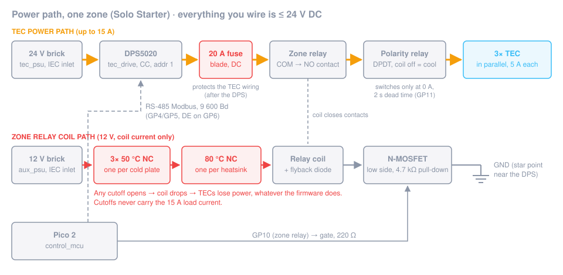

# Step 3: Power path

**Goal:** the TEC power path from the 24 V brick to the three TECs, with a fuse, a zone relay whose coil runs through
every thermal cutoff, and a polarity relay for heat/cool. Plus the 12 V auxiliary rail. **No mains wiring:** both
bricks plug into the wall with their own certified cords.

**Time:** 3–4 h.

## Parts

| Role / item | Qty | Notes |
|---|---|---|
| `tec_psu` (24 V, ≥ 280 W, IEC inlet) | 1 | plus the mating connector for its DC output |
| `aux_psu` (12 V, 80 W class, IEC inlet) | 1 | Solo load ≈ 40 W, within the 80 % rule |
| `tec_drive` (DPS5020-class buck, Modbus) | 1 | Modbus address 1, 9 600 Bd |
| `polarity_relay`: DPDT relay ≥ 20 A, 12 V coil, **or** two SPDT relays with both coils driven together | 1 or 2 | heat/cool; the shopping list uses 2 × SPDT automotive relays |
| `polarity_relay`: zone (enable) relay, 12 V coil, load on the NO contact | 1 | the hardware TEC power switch |
| `polarity_relay`: 20 A DC blade fuse + inline holder rated for 20 A | 1 | |
| `thermal_cutoff` 50 °C NC | 3 | one per cold plate (mounted in [step 4](04-thermal-stack.md)) |
| `thermal_cutoff` 80 °C NC | 1 per heatsink | 3 with a tower cooler per TEC (the shopping list), 1 with one shared heatsink |
| TTL-to-RS-485 adapter *(no role yet)* | 1 | at the DPS |
| 1 Ω power resistor, ≥ 25 W, on a heatsink *(no role yet)* | 1 | bench test load |
| Wire 2.5 mm² (14 AWG) for the TEC path, 0.5 mm² for coils *(no role yet)* | | crimped ring / fork terminals |
| Lever or screw terminal blocks rated ≥ 20 A *(no role yet)* | 2 | TEC + and − busbars |

## Steps

### 3.1 Bench-test the DPS5020 on its own

Do this **before** the Pico talks to it, and from the module's front panel only.

1. Connect the 24 V brick to the DPS input. Plug the brick into the switched power strip.
2. Set the DPS from its front panel to **5.00 V, 2.00 A**, output off.
3. Connect the 1 Ω power resistor (on its heatsink) to the output, with the multimeter in series on the 10 A range.
4. Turn the output on for ~30 s. Note displayed U/I, meter current and resistor temperature.
5. Set U to **14.00 V** with nothing connected to the output and confirm with the meter: this is the voltage ceiling
   the firmware will write (`TEC_VOLTAGE_CEILING_V`).
6. In the DPS settings, set the **Modbus address to 1** and the **baud rate to 9 600** (see your module's manual for
   how; on many units it is a menu entered by holding a key at power-on).
7. Optional, not part of the documented design and untested: set the module's own protections (OVP ≈ 14.4 V, the TEC
   rating; OCP ≈ 16 A) as an extra layer. Write down what you set.

⚠️ **Don't let the Pico drive the 1 Ω resistor.** With the Solo constants the firmware asks for 15 A, and the 14 V
ceiling would allow ~14 A, about 200 W into the resistor. Resistor tests stay at 1–2 A from the front panel. (If you
want a firmware-driven resistor test, use a source build with a temporarily low `MAX_TEC_CURRENT_A`, see
[step 6](06-software.md).)

### 3.2 RS-485 at the DPS

1. Connect the TTL-to-RS-485 adapter to the DPS communication header. **Check the header pinout and voltage in your
   module's manual**; this is not documented in the project yet. Power the adapter from the header if it provides the
   right voltage, otherwise from the control board's 5 V rail with a common GND.
2. Run a twisted pair (A, B) plus GND from the adapter to the control board's RS-485 terminal.
3. 120 Ω termination at both ends, no more.

### 3.3 Fuse and zone relay

1. From the DPS output **+**, run 2.5 mm² wire to the **20 A fuse holder**, then to the zone relay **COM**.
2. Zone relay **NO** → polarity relay supply + (see 3.4).
3. DPS output **−** → polarity relay supply − (see 3.4).

The fuse sits **after the DPS** (`WIRING.md`): at ~15 A output it protects the TEC wiring. The brick's own
overcurrent protection covers the input side.

### 3.4 Polarity relay (DPDT)

Wire it as a standard DPDT reversing switch, so that **coil off (GP11 LOW) = cool**:

| Relay terminal | Connect to |
|---|---|
| COM1 | TEC + busbar (all three red leads) |
| COM2 | TEC − busbar (all three black leads) |
| NC1, NO2 | supply + (from the zone relay NO) |
| NO1, NC2 | supply − (DPS output −) |

Coil off: TEC red = +, which cools the cold-plate face if the TECs are mounted as in [step 4](04-thermal-stack.md).
Coil on: reversed = heat.

**Two SPDT relays instead of one DPDT** (the shopping list's choice): relay A is pole 1, relay B is pole 2 in the
table above (COM, NC, NO; on ISO automotive relays these are pins 30, 87a, 87). Wire **both coils in parallel** to the
GP11 driver, each with its own flyback diode, so they always switch together. Check the NC rating of your relays:
in cool mode the 15 A flows through the NC contacts.

The `polarity_relay` notes warn that the A102-class relay's NC contacts are marginal at 18 A and high temperature.
That concern is for Duo (4 TECs × 4.5 A). **Solo runs 3 × 5 A = 15 A, inside that relay's NC rating (20 A at
14 V DC)**, so the standard wiring above is fine for this kit. If you ever raise the current, revisit this.

The firmware only switches the polarity relay when the DPS output is off and reads back < 0.1 A, with a 2 s dead time.
The relay never breaks current; still, it must be DC-rated.

### 3.5 Cutoff chain and coil wiring

1. +12 V → **50 °C cutoff (plate 1) → 50 °C (plate 2) → 50 °C (plate 3) → 80 °C (heatsink 1) → 80 °C (heatsink 2)
   → 80 °C (heatsink 3)** in series → zone relay coil + → coil − → MOSFET drain (GP10 driver from
   [step 2](02-control-board.md)). That is **six cutoffs** with one tower cooler per TEC; with one shared heatsink, four.
   One 80 °C cutoff per heatsink, as in `WIRING.md` and `SAFETY.md`.
2. Flyback diode across the zone relay coil, cathode to coil +.
3. Put a 2-pin connector into the chain near the control board. Unplugged, the chain is open and the zone relay
   **cannot** close, whatever the firmware does. That is the point.
4. Polarity relay coil: +12 V directly → coil → MOSFET drain (GP11 driver). It does not need the cutoffs because it
   never carries power on its own; the zone relay does.

⚠️ **Cutoffs never sit in the 20 A load path.** They are rated well under 1 A for some parts; they switch the coil only.

### 3.6 12 V auxiliary rail

The 12 V brick feeds: the 5 V buck (control board + hub), the cutoff chain and relay coils, the pump, the heatsink
fans and the leak sensor module. Bring it to a small distribution terminal block. Its negative goes to the star point.

### 3.7 Star ground

24 V brick −, DPS input −, 12 V brick − and the control board GND meet at **one** point near the DPS. No other ground
connections between the high-current side and the logic side.

## ✅ Checkpoint (TECs not connected yet; the TEC busbars stay open)

- [ ] 24 V brick at the DPS input, idle: **23.5–24.5 V**.
- [ ] Front panel test, 1 Ω load at 2.00 A: DPS display **≈ 2.0 A / ≈ 2.0 V**; series meter **2.0 A ± 0.1 A**.
- [ ] Open-circuit output at U-set 14.00 V: meter **14.0 V ± 0.1 V**.
- [ ] Fuse holder continuity: **< 0.1 Ω**.
- [ ] Cutoff chain at room temperature, measured end to end (12 V off): **< 1 Ω**. Unplug any one cutoff: **open**.
- [ ] Zone relay: with the gate test from step 2 (3.3 V via 1 kΩ on GP10's gate) it clicks **only** while the cutoff
      chain is plugged in. Chain unplugged: no click.
- [ ] Polarity at the TEC busbars, with the 1 Ω resistor as a dummy load there, DPS front panel at 1 A, zone relay
      held on with the gate test: **GP11 low → TEC + busbar positive**; switch the DPS output **off**, then energize the
      polarity relay: **TEC + busbar negative**. Always change polarity with the output off.
- [ ] Star ground: resistance between 24 V −, 12 V − and control board GND: **< 0.1 Ω**.

## If it fails

- **DPS output collapses under load:** input wiring too thin or a loose connector; check the voltage at the DPS input
  under load (should stay > 23 V).
- **Zone relay clicks with the chain unplugged:** the coil has a second +12 V path. Find it before you go on.
- **Fuse holder gets warm at 2 A:** poor contact or a holder not rated for 20 A. It will fail at 15 A.
- **Polarity reversed:** swap the wires at NC1/NO1 *and* NC2/NO2, or define it in step 4 when you check the TEC
  orientation. Only the relation "coil off = cold plate gets cold" matters.
