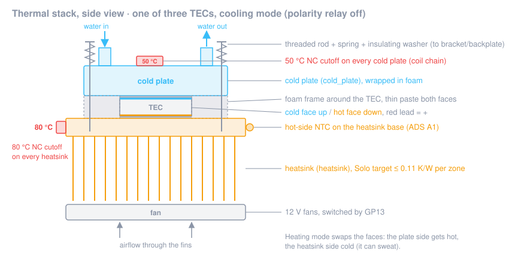

# Step 4: Thermal stack

**Goal:** three TEC sandwiches (cold plate / TEC / heatsink) with even clamping pressure, the right TEC orientation,
a 50 °C cutoff on every cold plate, an 80 °C cutoff on every heatsink, and the hot-side NTC on the heatsink base.

**Time:** 3–4 h.

## Parts

| Role / item | Qty | Notes |
|---|---|---|
| `tec_module` (40 × 40 mm, 127 couples, Imax ≈ 6 A) | 3 | from a seller with a datasheet |
| `cold_plate` (40 × 40 mm aluminium water block, G1/4 or barbed) | 3 | all aluminium **or** all copper in the loop, never mixed |
| `heatsink` (≤ 0.11 K/W per zone with fans on) | 1–3 | e.g. one CPU tower cooler per TEC; the real K/W is a measurement target |
| Heatsink fans, 12 V (120 mm class) *(no role yet)* | as needed | switched by GP13 |
| `thermal_cutoff` 50 °C NC | 3 | one per cold plate |
| `thermal_cutoff` 80 °C NC | 1 per heatsink | |
| `temp_sensors`: 10k NTC for the heatsink base | 1 | the A1 channel |
| Non-conductive thermal paste *(no role yet)* | | |
| M3/M4 threaded rod, nuts, **springs**, insulating (nylon) washers, 3 mm aluminium backplate *(no role yet)* | 1 set per stack | the coolers' CPU-socket mounts don't fit a TEC; this replaces them |
| Closed-cell foam, ~4 mm (TEC thickness) *(no role yet)* | | frame around each TEC, and insulation for the cold plates |
| Kapton tape or a small clamp bracket for sensors *(no role yet)* | | |

## Orientation: which side gets cold

In cooling mode the **cold face of every TEC must touch its cold plate**, and the hot face the heatsink. Coil off on
the polarity relay = cool ([step 3](03-power-path.md)), and that puts **red = +** on all TECs.

On most TEC1-12706-class modules the printed side is the cold side with red on +, but sellers differ. Check every
module:

1. Put the TEC on the heatsink with a dab of paste, printed side up.
2. From the DPS front panel, red = +, **1.0 A for at most 10 s**.
3. Touch the top face: if it gets cold, the top is the cold side. Mark it with a marker. If it gets warm, the bottom
   is the cold side; mark that.

⚠️ Never power a TEC without a heatsink, not even for a few seconds at full current. At 1 A on a heatsink for 10 s it
is safe.

## Steps

### 4.1 Test the cutoffs before mounting

Retail listings often mix up NO and NC (`thermal_cutoff` notes). For **each** cutoff:

1. Multimeter on continuity across the two terminals at room temperature: **closed** (beep).
2. Heat it with the hot-air gun next to your reference thermometer probe. It must **open near its rating**
   (50 °C or 80 °C, ± 5 °C tolerance) and close again as it cools.
3. Write down the measured opening temperature of each unit. Reject parts that open more than 5 °C off.

### 4.2 Prepare the surfaces

1. Clean the cold plate base, both TEC faces and the heatsink base with isopropyl alcohol. They must be flat and free
   of burrs.
2. Cut a foam frame for each TEC: outer size as the cold plate, inner hole 40 × 40 mm. It reduces heat leaking back from
   the hot to the cold side around the TEC and keeps condensation off the TEC edges.

### 4.3 Assemble each sandwich

1. Thin, even layer of non-conductive paste on the heatsink base where the TEC goes. Thin means you can almost see
   the metal through it.
2. Place the TEC **cold side up** (your marking), leads pointing to where the wiring goes.
3. Thin layer of paste on the TEC's top face. Place the foam frame, then the cold plate, ports pointing the way the
   tubing will run.
4. Clamp: four threaded rods hold the cold plate against the cooler base, anchored on the cooler's mounting bracket
   or on a backplate (a tower cooler's CPU-socket mount doesn't fit a TEC; see the mounting line on the
   [shopping list](../../hardware/shopping/solo-starter.md)). Each rod gets a spring and an insulating washer on the
   cold-plate side, so the block and the cooler are not connected through metal. Tighten **crosswise, a quarter turn at
   a time**, until the springs are compressed by the same amount. Uneven pressure cracks TECs.
5. Clamping force: follow your TEC's datasheet. The project has no measured value yet; *cold-plate thermal resistance
   with real clamping* is open measurement item 2 in [OPEN-DECISIONS.md](../design/OPEN-DECISIONS.md). Write down
   what you did (screw size, spring, compression) so your measurement can be compared.

### 4.4 Mount the cutoffs and the hot-side NTC

1. **50 °C cutoff on each cold plate:** on the plate body (not on a tube), with a dab of paste, held by a bracket, screw
   or a clamp. It must feel the water-side temperature of the TEC face, which is what it protects against
   (`02-electrical-safety.md`: the face runs above the water when heating).
2. **80 °C cutoff on each heatsink base:** as close to the TEC as the fins allow, with paste and a bracket.
3. **Hot-side NTC (A1):** on the heatsink base next to the TEC that will run hottest (the middle one if they share a
   heatsink; with one cooler per TEC, pick the one with the shortest fan airflow path and note which). Paste and kapton
   tape, or a drop of thermal epoxy. This is the sensor for the 75 °C firmware trip.
4. Wire the cutoffs into the chain from [step 3](03-power-path.md#35-cutoff-chain-and-coil-wiring), with crimped or
   soldered and heat-shrunk joints. The chain carries only the relay coil current.

> **Note:** the firmware reads one water NTC and one hot-side NTC per zone, so only one heatsink is watched in
> software; extra sensors per cold plate are planned (`temp_sensors` role). The bimetal cutoffs on
> every plate and heatsink are your per-TEC protection. Don't skip any of them.

### 4.5 TEC wiring

Connect all three red leads to the TEC + busbar and all three black leads to the TEC − busbar (parallel). Strain-relieve
the thin TEC leads so the sandwich doesn't pull on them.

### 4.6 Fans and insulation

1. Mount the fans so they blow through the fins; connect them to the GP13 driver (on/off for now; PWM is future work in
   the firmware). With three tower coolers that is up to **six fans** on one output: check that the driver and the
   12 V budget cope. 4-pin PWM fans with the PWM pin left open run at **full speed**, which is loud; fine for the bench,
   a problem for the bedroom (target ≤ 30 dB(A) at 1 m).
2. Wrap each cold plate and its fittings in closed-cell foam, leaving the cutoffs' leads accessible. Below the room
   dew point, anything uninsulated will sweat (`02-electrical-safety.md`, Condensation).

## ✅ Checkpoint

- [ ] Every cutoff opened within ± 5 °C of its rating in the hot-air test (values in the build log).
- [ ] Each TEC's cold side is marked and faces its cold plate.
- [ ] Cutoff chain end to end at room temperature: **< 1 Ω**; heat any one cold-plate cutoff with the hot-air gun:
      chain **opens**.
- [ ] Resistance across the TEC busbars (DPS disconnected, measured quickly because the TECs generate a small voltage
      when warmed): **≈ 0.6–0.7 Ω** for three 12706-class modules in parallel (datasheet ≈ 1.98 Ω each).
- [ ] Hot-side NTC node voltage at room temperature: **≈ 1.6–1.9 V** (see [step 2](02-control-board.md#-checkpoint-pico-not-yet-flashed)).
- [ ] Springs evenly compressed, no TEC visibly tilted, no paste squeezed onto the TEC leads.

## If it fails

- **Busbar resistance much higher than 0.7 Ω:** a TEC lead not making contact. Much lower (≈ 0 Ω): a short at the
  terminal block.
- **A TEC is cold on both sides / warm on both sides in the orientation test:** damaged module or no heatsink contact.
  Replace it; quality varies a lot between sellers (`tec_module` notes).
- **Cutoff opens at 40 °C or not at all:** wrong part (NO instead of NC, or wrong rating). Don't use it.
