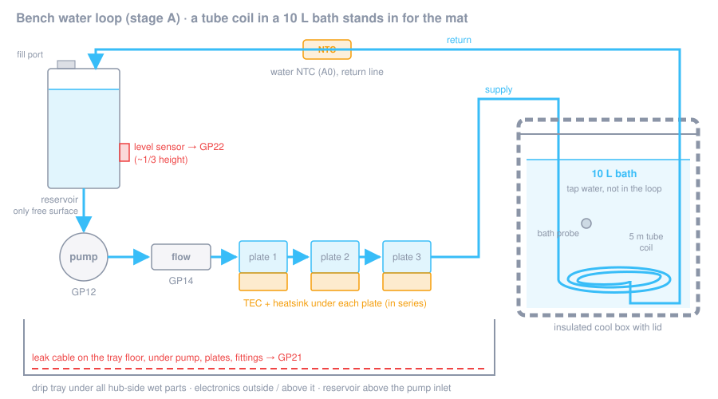

# Step 5: Water loop (bench)

**Goal:** a closed loop through the three cold plates and a **tube coil lying in a ~10 L insulated water bath** that
stands in for the mat, with the flow sensor, the inline water NTC, the reservoir level sensor and the leak sensor in
place. Then a **24 h leak test** with the electronics unpowered.

**Time:** 3 h hands-on, then 24 h waiting.



## Bench topology

This is the guide's suggestion for stage A, matching the [shopping list](../../hardware/shopping/solo-starter.md)
(cool box + 5 m tube coil). It hasn't been tried yet. Better ideas are welcome.

```
reservoir (fill port, level sensor) → pump → flow sensor → cold plate 1 → 2 → 3 ─┐
     ↑                                                                          │ supply line
     └── water NTC (A0, inline, return line) ←── return line ←── 5 m tube coil ←┘
                                                                 (in a 10 L bath)
```

- The **reservoir stays the only free water surface** in the loop, as in the real design (`01-thermal-fluidics.md`):
  air purges through it, and the level sensor watches it.
- The **bath is not part of the loop.** The loop water runs through a coil of tubing that lies in ~10 L of water in an
  insulated cool box, like the mat lies under a body. The loop keeps a small volume (about 1 L), so a leak on the hub
  side can't drain the bath, and the bath water can be plain tap water.
- The three cold plates are **in series** (one flow path, one flow sensor). The docs don't fix this; series is the
  simplest and keeps flow through every plate equal. The water warms by ~2 K across the plates at full load, which is
  fine.
- 10 L of water has a heat capacity of ≈ 41.8 kJ/K, about seven times the modelled mat loop (5.8 kJ/K). Temperatures
  move slowly, which is what makes the measurements in [step 7](07-bench-commissioning.md) readable.
- The firmware's water NTC sees the **loop** water, not the bath. For the measurements you also need the **bath**
  temperature: a waterproof DS18B20 probe on the hub (ESPHome, logged in Home Assistant) or hand readings with your
  reference thermometer every 15 min.

## Parts

| Role / item | Qty | Notes |
|---|---|---|
| `reservoir` (≈ 0.5 L, top fill port, non-contact level sensor) | 1 | the level sensor output goes to GP22 |
| `pump` (12 V, tach, ≥ 0.5 L/min at ≥ 1 m head) | 1 | switched by GP12 |
| `flow_sensor` (reliable at 0.15–1 L/min) | 1 | output to GP14; the shopping list's YF-S401 has 7 mm barbs: use 10→6 mm reducers and short 6 mm ID tube |
| `temp_sensors`: inline G1/4 10k NTC | 1 | return line, ADS A0 |
| `leak_sensor` | 1 | sensing cable on the tray floor |
| Insulated cool box, ~10 L, with lid *(no role yet)* | 1 | the bench bath |
| 5 m of loop tubing for the coil *(no role yet)* | 1 | coiled flat on the box floor, weighted down |
| Waterproof DS18B20 probe + 4.7 kΩ pull-up, on the hub *(no role yet)* | 1 | optional, logs the bath temperature |
| Tubing + G1/4 fittings / barbs + hose clamps *(no role yet)* | | soft tubing; check every barb size against the flow sensor |
| Coolant: distilled water + corrosion inhibitor/biocide that protects aluminium *(no role yet)* | ≈ 1–2 L for the loop | `01-thermal-fluidics.md`: avoid mixing copper and aluminium |
| Drip tray *(no role yet)* | 1 | from [step 1](01-tools-and-safety.md), under all hub-side wet parts |
| Closed-cell foam tube insulation *(no role yet)* | | supply and return lines |

## Steps

### 5.1 Layout

1. Everything wet on the hub side stands in the drip tray. The control board, DPS, relays and bricks stand **outside or
   above** it. The cool box stands next to the tray, on a floor that may get wet.
2. The **reservoir is the highest point** of the hub-side loop and sits **above the pump inlet**: the pump is a
   centrifugal pump and needs water flowing into it.
3. Mount the reservoir's level sensor so it trips **well before air can reach the pump inlet**, for example at about
   one third of the reservoir height. Note the height.

### 5.2 The bath

1. Lay the 5 m tube coil flat on the floor of the cool box and weigh it down (a clean stone or a stainless weight) so
   it stays submerged. Both tube ends leave through two holes in the lid.
2. Weigh the water you pour in (kitchen scale, in batches): **m_bath** ≈ 10 kg. The coil must be fully covered. Write
   m_bath down; you need it for every measurement.
3. Put the bath temperature probe (DS18B20 or your reference thermometer) in the middle of the bath, not touching the
   coil.
4. Close the lid. Seal the tube holes loosely with foam so the box stays insulated.

### 5.3 Plumbing

1. Connect in this order: reservoir outlet → pump inlet; pump outlet → flow sensor (mind the arrow; ~5 cm of straight tube before it) → cold plate 1 →
   2 → 3 → supply line → coil inlet.
2. Coil outlet → return line → **inline water NTC** → reservoir return inlet.
3. Hose clamps on every barb. Route tubes so nothing presses on a fitting.
4. Insulate the supply and return lines with foam tube.

### 5.4 Leak sensor

Lay the leak sensing cable on the **tray floor**, under the lowest fittings: under the pump, the cold plates and the
flow sensor. Water runs down; the sensor must be where it ends up. Wire it to GP21 as in
[step 2](02-control-board.md#26-fail-safe-inputs-leak-and-level).

### 5.5 Fill and prime (electronics unpowered)

This and the leak test follow [SAFETY.md](../../SAFETY.md) checklist step 1: **pump only, on its own supply, with the
control board, the DPS and the 24 V brick unpowered.** The firmware's PRIME command only runs the pump for 60 s and
needs the level sensor to read OK, so it is not suitable for a 24 h test.

1. Unplug the 24 V brick. Disconnect the pump from the control board's GP12 driver and connect it **directly** to the
   12 V brick (through a switch if you have one).
2. Fill the reservoir. Switch the pump on in short bursts (2–3 s) while you keep topping up the reservoir; it pulls
   water into the cold plates and pushes air out through the coil into the reservoir.
3. When the reservoir level stays steady, let the pump run continuously. Tilt and tap the cold plates and lift the
   coil briefly to free trapped bubbles. Top up.
4. Run until no more bubbles come back into the reservoir (typically 10–30 min). Close the fill port.

⚠️ Never let the pump run dry, and never let the reservoir empty during priming.

### 5.6 24 h leak test

1. Wrap **every** fitting, barb and the flow sensor in a dry paper towel (a strip held with tape or a rubber
   band). Put a sheet of dry paper towel on the tray floor.
2. Run the pump continuously for **24 h**, electronics still unpowered. This pump-only run is the one exception to
   "never unattended" (SAFETY.md requires 24 h): no TEC, no high current, and the tray catches the loop volume. Stay
   in the home, and check it before you go to bed and when you get up.
3. Check at **1 h, 4 h and 24 h**: any damp spot on a towel = fix that joint, dry everything, restart the 24 h.
4. After 24 h with all towels dry, reconnect the pump to the GP12 driver.

## ✅ Checkpoint

- [ ] Bath mass m_bath written down: **≈ 10 kg** (your exact value). Bath temperature visible (HA or thermometer).
- [ ] After priming: no bubbles return to the reservoir; level steady; pump runs quietly (no gurgling).
- [ ] Flow is visible (sensor turbine spins, or water visibly returns into the reservoir). The design target is
      **0.4–0.6 L/min**; the interlock needs **≥ 0.15 L/min**. You measure the real value in step 7.
- [ ] **24 h leak test: every paper towel dry.** Date and time in the build log.
- [ ] Level sensor: with the pump running, lower the reservoir level below the sensor (drain a little into a jug):
      GP22 goes **HIGH (≈ 3.3 V)**; refill: **LOW**. Measure with the multimeter on the control board (12 V on for the
      board only, 24 V brick still unplugged).
- [ ] Leak sensor: touch the sensing cable with a wet towel: GP21 goes **HIGH (≈ 3.3 V)**. Dry it (and reset the module
      if it latches).

## If it fails

- **Pump runs but nothing flows:** air lock at the pump. Switch off, top up, tilt the pump so its outlet points up,
  burst-start again. Check the reservoir is above the pump inlet.
- **Constant fine bubbles:** a fitting on the suction side (reservoir → pump) sucks air without dripping. Re-seat it.
- **Coil floats up or traps air:** weigh it down more evenly; lift each loop briefly while the pump runs.
- **Level sensor doesn't react:** capacitive non-contact sensors need a thin non-metallic wall and adjusting; check its
  sensitivity setting, and its output polarity (LOW = water present, or add the inverter from step 2).
- **Quick couplings drip after disconnecting:** some don't self-seal (`quick_disconnect` notes). That matters in stage B;
  test each coupling here over a towel.
