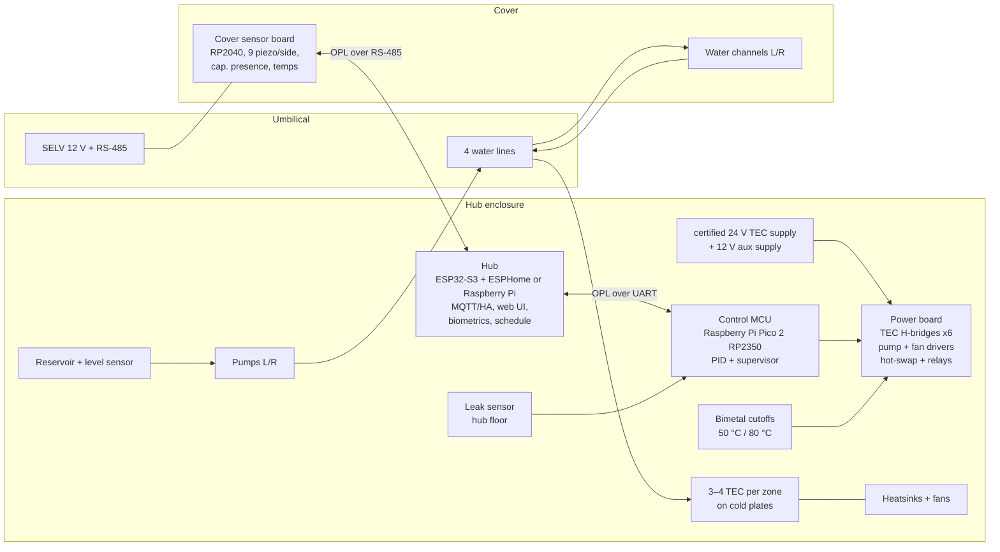

# Open Bed Climate — System Architecture

Clean-room design for an open-source, water-based bed climate system in the class of the Eight Sleep Pod.
It is based on **public facts only** (product pages, FCC public exhibits, published community research, see
`../research/prior-art.md`). No vendor firmware, code or confidential documents are used. Protocols are our own.

## Goals
- Per-side water temperature control, 13–43 °C setpoint range, two independent zones (or one for Solo).
- Presence, heart rate, breathing rate, movement from sensors in the cover; local-only by default.
- Fully local operation: no cloud, no account, no subscription. Home Assistant / MQTT / local web UI.
- Safety first: mains never leaves the hub; the cover carries only water and SELV wiring.
- Buildable from standard parts. **Tier 0** kits use off-the-shelf modules only. **Tier 1** adds two reference PCBs
  (power board, cover sensor board). See [`hardware/README.md`](../../hardware/README.md).

## Non-goals (v1)
- Compatibility with vendor covers/hubs (possible later via Pod 3–5 community protocol work, not in scope).
- Designing our own adjustable base or speaker; we integrate existing products through Home Assistant instead.

## Block diagram (Tier 1 reference; Tier 0 replaces the custom boards with off-the-shelf modules)

## Split of responsibilities

| Layer | Runs on | Owns | Must survive |
|---|---|---|---|
| Hardware safety | bimetal cutoffs on relay coils, hot-swap controllers, PSU OVP | absolute limits | MCU crash, firmware bugs |
| Real-time control | Control MCU, Pico 2 (Rust or C), same in both tiers | TEC current loop, PID, supervisor (`software/opod/src/opod/control.py` is the reference) | host crash: goes SAFE after 10 s without heartbeat |
| Hub software | ESP32-S3 with ESPHome (Tier 0 default) or a Linux SBC (heavier biometrics) | schedules, biometrics, MQTT/HA, web UI, OTA of MCU | can be rebooted at any time |
| Cover sensing | Cover MCU | sampling, sync, framing | — |

Key principle: **the hub can never cause an unsafe state**. It can only request setpoints within 13–43 °C; the MCU
clamps them, and hardware cutoffs clamp the MCU.

## Documents
1. `01-thermal-fluidics.md` — TEC sizing, water loop, heat rejection (backed by `opod.thermal`)
2. `02-electrical-safety.md` — power, isolation, fault handling, standards
3. `03-sensing-biometrics.md` — cover sensors, BCG signal chain, algorithms
4. `04-firmware-protocol.md` — OPL wire protocol (backed by `opod.protocol`)
5. `05-bed-software.md` — hub services, schedule, HA integration
6. `BOM.md` — Tier 1 (Duo Reference) bill of materials; Tier 0 parts are in `hardware/PARTS.md`
7. `OPEN-DECISIONS.md` — what still needs a decision or a prototype measurement
