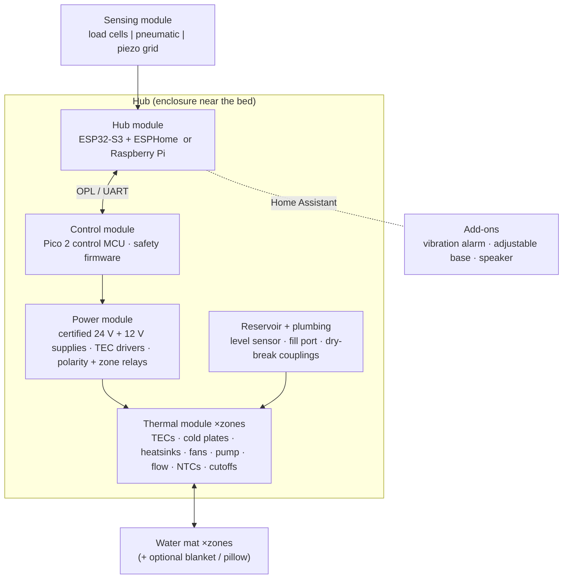

# Open Bed Climate hardware

Open Bed Climate is built from **modules**. Each module is made of **roles** (e.g. "pump: 12 V, tach, ≥ 0.5 L/min at 1 m"),
and each role can be filled by different standard parts. Pick a **kit** to start, then adapt it.

## Kits

| Kit | Tier | Zones | TEC / zone | Sensing | Power supplies | Coldest water* | For |
|---|---|---|---|---|---|---|---|
| [Solo Starter](kits/solo-starter.toml) | 0 | 1 | 3 | load cells | 1× 24 V 280 W + 1× 12 V 80 W, plug-in | ~21.7 °C | first build, single sleeper, lowest cost |
| [Duo Standard](kits/duo-standard.toml) | 0 | 2 | 4 | pneumatic | 2× 24 V 280 W + 1× 12 V 120 W, plug-in | ~18.8 °C | couples, strongest cooling from standard parts |
| [Duo Reference](kits/duo-reference.toml) | 1 | 2 | 4 | piezo grid | 24 V 750 W in a closed power module | ~18.5 °C | experienced builders, best biometrics |

\* Sleeper in bed, 25 °C room, from the thermal model (`software/obc`). Cooler rooms or pre-cooling an empty bed get
lower. Every kit reaches 43 °C (the safety cap) for warming. **The tests check every kit's claims**, so your
own kit file gets the same check.

**Tiers**
- **Tier 0 — modules only:** no custom PCB. Off-the-shelf boards, modules and PC-watercooling parts, connected
  on a DIN rail or a carrier plate. Soldering is optional.
- **Tier 1 — reference PCBs:** a power board (6 TEC channels, protection, relays) and a cover sensor board.
  Smaller, quieter and cleaner, but needs PCB assembly.

Both tiers run the **same control firmware** and speak the same protocol ([OPL](../docs/design/04-firmware-protocol.md)),
so parts, software and documentation are shared.

## Module map

| Module | Role ids in [`parts.toml`](parts.toml) | Safety-relevant? |
|---|---|---|
| Power | `tec_psu`, `aux_psu`, `tec_drive`, `polarity_relay` | **yes** |
| Control | `control_mcu`, `temp_sensors`, `thermal_cutoff`, `leak_sensor` | **yes** |
| Hub | `hub_controller` | no (it can only request setpoints) |
| Thermal (per zone) | `tec_module`, `cold_plate`, `heatsink`, `pump`, `flow_sensor`, `reservoir` | partly (flow, level) |
| Water mat | `water_mat`, `quick_disconnect` | yes (pressure, leaks) |
| Sensing | `bcg_sensing` | no |
| Add-ons | `vibration_motor`, `adjustable_base` | no |

**Tier 0 power chain per zone:** 24 V IEC-inlet supply → DPS-class programmable buck module (current-controlled,
Modbus from the Pico 2) → DC fuse → zone relay (thermal cutoffs on its coil) → DPDT polarity relay → 3–4 TECs in
parallel. No custom power electronics and smooth DC. The driver's current limit is software; the fuse, zone relay and
supply protection are the hardware backstops.

See [`PARTS.md`](PARTS.md) for the role requirements and verified example parts, and [SAFETY.md](../SAFETY.md)
for what you may and may not change.

**Shopping list:** [Solo Starter, prototype 0](shopping/solo-starter.md) — concrete products, shops and prices (bench build, then bed).

**Carrier PCB (optional):** instead of the perfboard, the [Tier 0 carrier PCB](pcb/carrier/README.md) holds the
Pico 2, the ESP32-S3 hub, the ADS1115, RS-485, the output drivers and all terminals on one 100 × 100 mm board that
can be ordered assembled. Rev A is untested: review it before ordering.

## Status
Design phase. No build has been completed and measured yet, so **be the first** and post a
[build report](../.github/ISSUE_TEMPLATE/build-report.yml).
