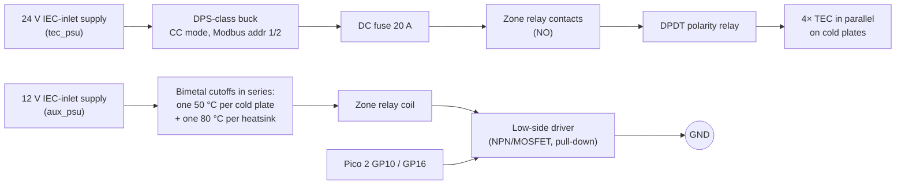

# Tier 0 wiring (Duo Standard)

> ⚠️ Read [SAFETY.md](../SAFETY.md) first. Everything below is **≤ 24 V DC**. Mains only goes into certified
> plug-in power supplies. This plan has **not been built yet**; please report what you find (build report issue).

The pin map is the source of truth in [`firmware/opod-pico2/src/board.rs`](../firmware/opod-pico2/src/board.rs).
If you change pins, change them there and here.

## Power and TEC path (per zone)

- **The 20 A fuse sits after the DPS**, where the current is highest (the DPS can deliver up to 20 A; the 24 V side is
  limited to ~11.7 A by the supply's own protection). Solo Starter: 3 TECs, 3 cold plates, 3 heatsinks, zone 0 only.
- **The zone relay sits between the TEC driver and the TECs.** If any cutoff opens, the coil drops and the TECs lose
  power, whatever the firmware or the DPS module does.
- Every relay, pump and fan driver input has an **external 4.7 kΩ pull-down** to GND, so a Pico that is in reset,
  unflashed or crashed leaves everything off. Don't rely on the RP2350's internal pull-downs: erratum E9 can latch a
  pad near mid-rail with a weak pull-down, so the external one must be **≤ 8.2 kΩ** (10 kΩ is not enough).
- The firmware closes the zone relay only when the DPS output state and setpoint are confirmed over Modbus. The
  **polarity relay** (GP11 / GP17) switches only after the DPS output is off and reads back < 0.1 A.
- Ground: connect the 24 V negative, the 12 V negative and the Pico GND at **one** star point near the DPS modules.

## Signals

| Pico 2 pin | Function | Connects to |
|---|---|---|
| GP0 / GP1 | UART0 TX / RX, OPL 460 800 Bd | ESP32-S3 hub RX / TX (cross over), common GND |
| GP4 / GP5 | UART1 TX / RX, Modbus 9 600 Bd | RS-485 transceiver DI / RO (3.3 V type) |
| GP6 | RS-485 DE + /RE | transceiver direction (high = transmit) |
| GP8 / GP9 | I2C0 SDA / SCL | ADS1115 @ 0x48 (3.3 V) |
| GP10 / GP16 | zone relay, zone 0 / 1 | relay driver input (via the cutoff chain, see above) |
| GP11 / GP17 | polarity relay, zone 0 / 1 | relay driver input; low = cool, high = heat |
| GP12 / GP18 | pump on, zone 0 / 1 | MOSFET / pump enable (D5 pumps: PWM input, later) |
| GP13 / GP19 | fans on, zone 0 / 1 | MOSFET for the heatsink fans |
| GP14 / GP20 | flow sensor pulse, zone 0 / 1 | open-collector output, internal pull-up |
| GP21 | leak sensor | **LOW = dry**; HIGH = leak *or broken wire*. External 10 kΩ pull-up to 3.3 V |
| GP22 | water level | **LOW = level OK**; HIGH = low *or broken wire*. External 10 kΩ pull-up to 3.3 V |

Both inputs are wired so that a broken wire reads as a fault. Choose sensor modules (or add an inverter) whose
output is LOW in the good state.

The DPS modules have a TTL UART. Put an RS-485 adapter on each module and run one RS-485 bus (A/B, 120 Ω
termination at both ends) to the Pico's transceiver. Give the modules Modbus addresses 1 (zone 0) and 2 (zone 1).

## Temperature sensors (ADS1115 @ 0x48)

| ADS channel | Sensor |
|---|---|
| A0 | zone 0 water (inline G1/4 NTC, return line) |
| A1 | zone 0 TEC hot side (NTC on the heatsink base) |
| A2 | zone 1 water |
| A3 | zone 1 TEC hot side |

Each NTC sits in a divider: 3.3 V → 10 kΩ (0.1 %) → node (ADS input) → NTC → GND. Calibrate every NTC and enter
`r25`/`beta` in `board.rs` (`NTC_CAL`). Open and shorted sensors are detected and trip `SENSOR_INVALID`.

## Bring-up order (do not skip)
1. Flash the firmware with nothing connected to the outputs. Check the defmt log over the debug probe.
2. Connect the relays without TEC power. Send `SET_TARGET` from the hub and watch the relays click in the right order
   (polarity changes only at zero current).
3. Bench-test each DPS module on a 1 Ω power resistor, not on TECs. Check the Modbus register map and the current
   read-back (`DPS_MAP` in `board.rs`).
4. Plumbing leak test (SAFETY.md checklist step 1).
5. Then the full SAFETY.md commissioning checklist.
