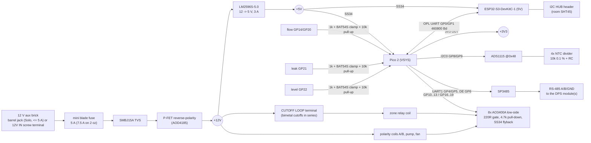

# Tier 0 carrier PCB, Rev A

> ⚠️ **Rev A is UNTESTED: review it before you order.** Nobody has built or measured it yet. Read
> [SAFETY.md](../../../SAFETY.md) first. Please post a build report if you build one.

The carrier replaces the perfboard and loose breakout boards of [step 2](../../../docs/build/02-control-board.md)
with one 100 × 100 mm, 2-layer board, so a small series (~10 units) can be ordered assembled. It carries **signals
and the 12 V aux rail only**. The TEC high-current path stays off-board, wired with ≥ 2.5 mm²:
24 V brick → DPS5020 → 20 A fuse → zone relay → polarity relays → TECs
([step 3](../../../docs/build/03-power-path.md)).

What plugs in:
- Raspberry Pi Pico 2 on 2 × 1x20 female headers
- ESP32-S3-DevKitC-1 on 2 × 1x22 female headers
- Screw terminals for every external wire: 5.08 mm for 12 V loads and power, 3.5 mm for sensors

Licence: CERN-OHL-S-2.0, like the rest of the hardware.

## Block diagram



## Terminals and pins (cross-referenced to `board.rs`)

The pin map comes from [`firmware/opod-pico2/src/board.rs`](../../../firmware/opod-pico2/src/board.rs).
[`software/opod/tests/test_carrier_pcb.py`](../../../software/opod/tests/test_carrier_pcb.py) parses
`carrier.kicad_pcb` and checks it against `board.rs` and
[`hub/esphome/opod-hub-common.yaml`](../../../hub/esphome/opod-hub-common.yaml) in CI. Pin 1 is the square pad.
Zone 0's terminals run along the top edge, zone 1's along the bottom edge (mirrored). Silk labels sit next to each
block, with the pin names written in left-to-right order.

| Terminal (zone 0 / zone 1) | Pins | Function | Pico 2 (`board.rs`) |
|---|---|---|---|
| J13 / J20 `CUTOFF LOOP` | 1 `12V` out, 2 `RET` | +12 V out to the bimetal cutoffs in series (all 50 °C and 80 °C) and back. **The return is the only feed of the zone relay coil.** | none, pure hardware |
| J14 / J21 `ZONE RLY` | 1 `+` coil (from RET), 2 `−` driver | zone (enable) relay coil, flyback across the coil | GP10 / GP16 |
| J15 + J16 / J22 + J23 `POL A`, `POL B` | 1 `+` 12 V, 2 `−` driver | polarity relay coils: 2 × SPDT (shopping list) on A and B, both switched by one MOSFET, each with its own flyback. **One DPDT relay: use POL A only.** | GP11 / GP17 (low = cool) |
| J17 / J24 `PUMP` | 1 `+` 12 V, 2 `−` | pump, ≥ 2 A, PWM-capable MOSFET | GP12 / GP18 |
| J18 / J25 `FAN` | 1 `+` 12 V, 2 `−` | heatsink fans, ≥ 2 A | GP13 / GP19 |
| J19 / J26 `FLOW` | 1 `5V`, 2 `G`, 3 `S` | hall flow sensor; 1 kΩ series, BAT54S clamp to 3.3 V/GND, 10 kΩ pull-up (5 V outputs are safe) | GP14 / GP20 |
| J4 / J6 `NTC WTR` | 1 `N` node, 2 `G` | water NTC: 3.3 V → 10 kΩ 0.1 % → node → NTC → GND, 1 kΩ/100 nF to the ADS | ADS1115 A0 / A2 |
| J5 / J7 `NTC HOT` | 1 `N`, 2 `G` | TEC hot-side NTC | ADS1115 A1 / A3 |

| Terminal (right edge) | Pins | Function | Pico 2 |
|---|---|---|---|
| J10 `RS-485` | 1 `A`, 2 `B`, 3 `G` | Modbus to the DPS module(s); JP1 `TERM` = 120 Ω across A/B (fit only if this end has no other termination) | UART1 GP4 (TX→DI) / GP5 (RO→RX), DE + /RE on GP6 (10 kΩ pull-down = receive) |
| J11 `LEAK` | 1 `12V`, 2 `G`, 3 `S` | leak module (powered from 12 V); contact to GND while dry. LOW = dry, open = fault | GP21 (10 kΩ pull-up) |
| J12 `LEVEL` | 1 `5V`, 2 `G`, 3 `S` | level sensor at 5 V; LOW = OK, open = fault. The clamp makes a 5 V output safe; the divider from the shopping list is not needed | GP22 (10 kΩ pull-up) |
| J2 `12V IN` | 1 `+12V`, 2 `GND` | 12 V aux brick (use this one for Duo) | |
| J1 barrel 5.5 × 2.5 | centre + | in parallel with J2. **Solo only, ≤ 5 A** | |
| J3 `STAR GND` | 1, 2 GND | **one** wire to the star point near the DPS (24 V −). Do not link 12 V − and 24 V − anywhere else | |

| Header | Pins | Notes |
|---|---|---|
| J9 `I2C HUB` | 1 ESP 3V3, 2 GND, 3 SDA = ESP32 GPIO8, 4 SCL = GPIO9 | room SHT45 for the dew-point guard. 4.7 kΩ pull-ups on board. The hub YAML only mentions the SHT45 in a comment; add `i2c: {sda: GPIO8, scl: GPIO9}` and an `sht4x` sensor, then set `room_temperature` / `room_humidity` |
| J8 `I2C PICO` | 1 3V3, 2 GND, 3 SDA = GP8, 4 SCL = GP9 | expansion on the ADS1115 bus (avoid address 0x48) |
| TP1–TP4 | 12V, 5V, 3V3, GND | test points (2 mm pads) |

All eight driver gates have a **4.7 kΩ pull-down** (RP2350-E9: ≤ 8.2 kΩ). An unflashed, crashed or reset Pico
leaves every output off, and the test checks every gate for it. Each zone relay coil gets +12 V **only** through its
CUTOFF LOOP terminal. An open cutoff or an unplugged loop drops the relay whatever the MCU does, and the test checks
that too. The flyback diode sits directly across the coil, so an opening bimetal never has to break the coil
current as an arc.

## Files

| Path | What |
|---|---|
| `scripts/design.py` | **source of truth**: every part with symbol, footprint, value, LCSC number and the net on each pin |
| `scripts/gen_lib.py` | project library: ESP32-S3-DevKitC-1 symbol, socket footprints for both modules |
| `scripts/gen_sch.py` | `carrier.kicad_sch`: one sheet, grouped by function, net labels on every pin, no-connect flags, power flags |
| `scripts/gen_pcb.py` | `carrier.kicad_pcb`: placement, nets, outline, silkscreen, net classes, JLC rules (`carrier.kicad_pro`) |
| `scripts/route.py` | Freerouting autoroute, GND pours on both layers, GND stitching vias |
| `scripts/silk.py` | post-route silkscreen pass: connector refs to F.Fab, test point / header / jumper labels, back-side labels for the NTC terminals hidden by the barrel jack |
| `scripts/fab.py` | ERC/DRC, Gerbers + drill, JLC BOM/CPL, full BOM, PDFs, renders into `fab/` |
| `build.sh` | runs all of the above |
| `fab/` | `carrier-rev-a-gerbers.zip`, `jlc-bom.csv`, `jlc-cpl.csv`, `bom-full.csv`, `carrier-schematic.pdf`, `carrier-assembly-top.pdf`, `carrier.net`, `reports/` (ERC, DRC), `renders/` |

Rebuild (KiCad 10, and Freerouting 1.9.0 on Java 17: `freerouting-1.9.0.jar` from
<https://github.com/freerouting/freerouting/releases/tag/v1.9.0>):

```sh
FREEROUTING_JAR=~/Downloads/freerouting-1.9.0.jar JAVA=/opt/homebrew/opt/openjdk@17/bin/java ./build.sh
```

Change the design in `scripts/design.py`, never in the generated KiCad files. Freerouting isn't deterministic, so a
rebuild gives different traces; re-run DRC and look at the renders.

## Board

- **100 × 100 mm, 2 layers**, 1.6 mm, M3 mounting holes (4, at the free spots, not the corners: the terminal rows
  run the full width). 126 footprints: 88 SMD parts for JLC assembly, the rest are THT/hand-soldered or holes.
- Track widths: signals 0.25 mm, loads (drains, coils, 5 V) 0.8 mm, 12 V 1.5 mm. GND pours on both layers, about
  200 vias including GND stitching. JLC-safe rules: clearance 0.2 mm (MSOP pads trimmed to TI's 0.30 mm land
  pattern), vias 0.6/0.3 mm, hole to hole ≥ 0.5 mm, copper to edge ≥ 0.3 mm. No copper under the ESP32 antenna.
- **Checks (Rev A as generated): ERC 0 violations. DRC 0 errors, 0 unconnected, schematic parity clean.**
  15 silkscreen-only warnings (small labels touching a pad or another label) are left; JLC clips silk on pads.
  Pin labels next to the terminals are 0.8 mm high: check they're legible in JLC's preview.
  Reports: `fab/reports/`.
- Renders: `fab/renders/render-top.png`, `render-bottom.png`, `render-3d.png`, `top-layers.svg`,
  `bottom-layers.svg`. The 12 × 12 mm inductor has no 3D model in KiCad's library and shows as a bare footprint.

## Ordering (JLCPCB)

1. **PCB**: upload `fab/carrier-rev-a-gerbers.zip`, 2 layers, 100 × 100 mm, 1.6 mm FR-4, HASL lead-free, 1 oz
   copper (5 A input). For Duo boards with all 12 V loads near their maximum, choose 2 oz outer copper (7.5 A, see
   limitations). Quantity 10.
2. **Assembly**: PCBA, Economic, top side, "Confirm parts placement". Upload `fab/jlc-bom.csv` and `fab/jlc-cpl.csv`.
3. In the BOM step, check every match. Parts **without an LCSC number** need one picked from JLC's library first:
   - AOD4185 (P-FET, TO-252, −40 V, ≤ 15 mΩ)
   - SS54 (5 A Schottky, SMC)
   - BZT52C12 (SOD-123)
   - 33 µH ≥ 4 A shielded 12 × 12 mm inductor
   - 100 µF 35 V and 220 µF 16 V electrolytics (6.3 × 7.7 mm, low ESR)
   - 10 kΩ **0.1 %** 0603 resistors (×4, NTC dividers: these set the temperature accuracy)

   The numbers marked "check" in `bom-full.csv` are the usual JLC basic parts but weren't confirmed on a product
   page while Rev A was drawn up.
4. In the placement preview, **check the rotation of every polarized part**: diodes, LED, electrolytics, SOT-23,
   ADS1115, SP3485, LM2596. KiCad and JLC rotation conventions differ for some packages; fix any wrong one in the
   preview.
5. **Hand-soldered THT parts** (not in the JLC files; buy them separately or add them as JLC THT assembly):

   | Qty | Part |
   |---|---|
   | 14 | screw terminal 5.08 mm, 2-pin (Phoenix MKDS 1,5/2-5.08 or compatible, e.g. KF128/DG128-2P) |
   | 4 | screw terminal 3.5 mm, 2-pin (NTC) |
   | 5 | screw terminal 3.5 mm, 3-pin (flow ×2, RS-485, leak, level) |
   | 2 + 2 | 1x20 and 1x22 female headers, 2.54 mm (Pico 2 / ESP32 sockets) |
   | 1 | DC barrel jack 5.5 × 2.5 mm, 3-pin THT, horizontal, with the pin layout of KiCad's `BarrelJack_Horizontal` (e.g. CUI PJ-063AH-class): **check the pins against the footprint**, a mismatched jack leaves GND or +12 V open |
   | 1 | Keystone 3568 mini blade fuse holder + ATM fuse: 5 A (1 oz board) or 7.5 A (2 oz board) |
   | 2 + 1 | 1x4 and 1x2 pin headers, jumper |
   | 4 | test points (2 mm pads): bare wire loops or nothing |

   Check each terminal block's footprint against your part. The Phoenix footprints assume the wire entry faces the
   board edge (verify on the 3D render before ordering).

### Cost estimate, 10 assembled boards (Oct 2026, rough)

| Item | ~USD for 10 |
|---|---|
| PCB 2 layers 100 × 100 mm, 1 oz | 5–10 (2 oz: +15) |
| PCBA setup + stencil | 10 |
| Extended-part fees (~10 unique extended parts × $3) | 30 |
| SMD components (ADS1115 ≈ $3 is the biggest item) | 60–80 |
| Placement and soldering | 5–10 |
| THT parts (≈25 terminals, sockets, jack, fuse holder) | 60–90 |
| Shipping to the EU + import VAT | 40–60 |
| **Total** | **≈ 210–290, i.e. ≈ €20–27 per board** |

That's without the Pico 2 and ESP32-S3-DevKitC-1 (about €6 + €15 each). Prices move: get a live quote.
AISLER (EU, PCB + assembly) or PCBWay take the same Gerbers. Their BOM formats differ: use `bom-full.csv` and
the KiCad position file `fab/reports/pos-kicad.csv`.

## Known limitations (Rev A)

- **Untested.** Not built, not powered, not measured. The first boards are a bring-up exercise: follow the
  [step 2 checkpoint](../../../docs/build/02-control-board.md) (gate pull-downs, reset test, rails) before you
  connect relays or TECs.
- **12 V current.** The 12 V traces are 1.5 mm (IPC-2221, external layer): about 4.5 A at +20 °C on 1 oz copper,
  about 7.5 A on 2 oz. Each zone's branch carries at most ~3.5 A (pump + fans + coils), but the input path carries
  the total. So: **1 oz board → 5 A fuse, ≤ 5 A total** (enough for Solo, ~3–4 A). **Duo near full load → order
  2 oz copper and fit a 7.5 A fuse.** Measure the real 12 V current at bring-up either way. The barrel jack is for
  ≤ 5 A only.
- **Reverse protection** drops ~0.1 V at 7 A (AOD4185, ~0.7 W). A 24 V brick plugged in by mistake makes the
  SMBJ15A TVS conduct and blows the fuse. It's a crowbar, so check the fuse after any wrong plug.
- **5 V back-feed.** The board's 5 V reaches the Pico and the ESP32 through Schottkys, so USB on either module
  never back-feeds into the board. Whether the DevKitC's own USB port can be back-fed from its 5V pin depends on
  the DevKitC revision. Prefer **not** to plug ESP32 USB in while the board is powered.
- **ESP32 row spacing** (22.86 mm) and pin order come from Espressif's DevKitC-1 v1.1 dimension drawing (DXF) and
  user guide. v1.0 boards have the same header. **Measure your module with calipers** before ordering. A clone with
  25.4 mm rows won't fit.
- **ESP32 antenna**: the antenna end has no copper on either layer, but the module still sits over the carrier's
  ground plane. Mount the carrier so the antenna isn't covered by metal.
- **Under-module parts**: low SMD parts sit between the socket rows of both modules. They are 8.5 mm below the
  module. Unplug the module to probe them.
- **Freerouting**: the traces are autorouted, not hand-optimised. Before ordering, look at the buck loop
  (LM2596 → SS54 → inductor → output cap) and the 12 V path in KiCad, and shorten them by hand if you can.
- **Pump/fan PWM**: the MOSFETs can switch at PWM rates, but the firmware drives them on/off today. 4-wire PWM
  fans and the DDC's PWM input aren't broken out.
- **No on-board RS-485 bias resistors and no TVS on A/B.** The DPS-side adapter usually biases the bus. Keep the
  bus short and inside the enclosure.
- **LCSC numbers**: about half were confirmed on a product page (marked in `bom-full.csv`). The rest need checking
  in JLC's BOM matcher, and a few must be picked (see Ordering).
