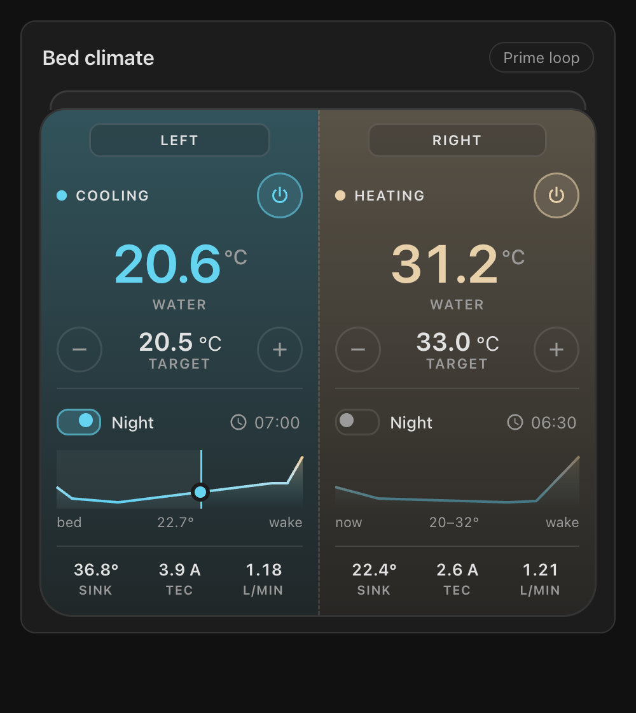
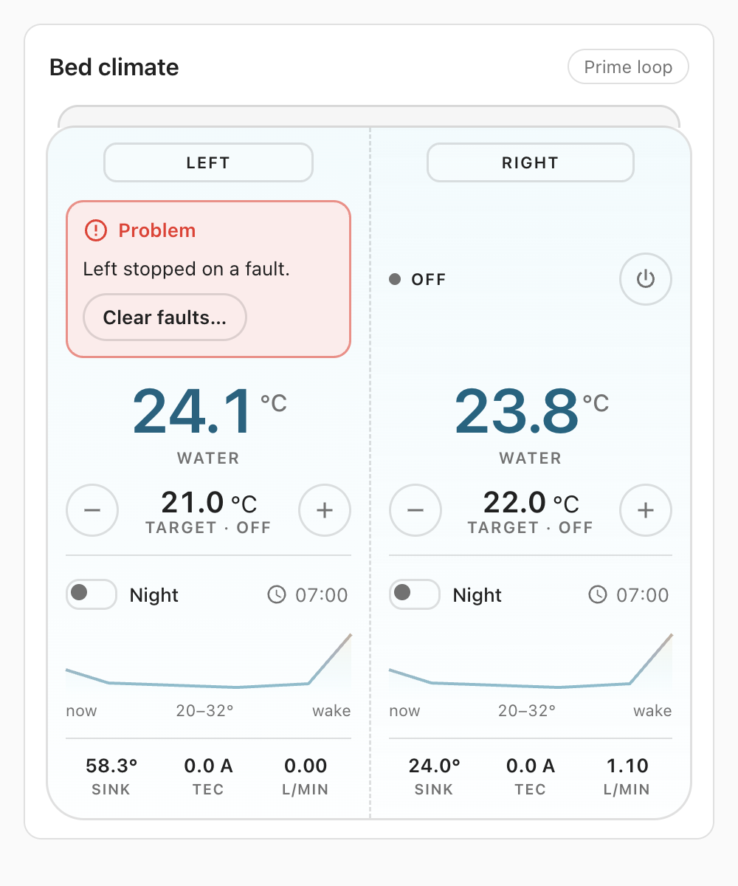

# Open Bed Climate card (Home Assistant)

A Lovelace dashboard card for the [Open Bed Climate hub](../esphome). It draws the bed, split into its sides, each
tinted by its water temperature on the project's cold-cyan → warm-amber scale (13–43 °C). Per side: water
temperature, target with − / + (0.5 °C steps), on/off, what it is doing (cooling / heating / idle / off), the night
program switch and wake time, a small night-curve chart with a "now" marker while the program runs, a fault banner
with **Clear faults** (asks first), and heatsink / TEC current / flow. A dead hub or a silent control board is shown
as such, not as stale numbers. Works in light and dark Home Assistant themes.




All states: [`screenshots/states-light.png`](screenshots/states-light.png).

## Install

1. Download `open-bed-climate-card.js` from the latest
   [release](https://github.com/moinsen-dev/open-bed-climate/releases) (it is one self-contained file).
2. Copy it to `/config/www/` on your Home Assistant (e.g. with the File editor or Samba add-on).
3. **Settings → Dashboards → ⋮ → Resources → Add resource**: URL `/local/open-bed-climate-card.js`, type
   **JavaScript module**. (Resources only show with *Advanced mode* on in your user profile.) After an update, bump
   the URL, e.g. `/local/open-bed-climate-card.js?v=2`, or clear the browser cache.
4. Edit a dashboard → **Add card** → *Open Bed Climate*. The picker fills in the entity ids of the standard hub; the
   visual editor has an entity picker per side. HACS: planned.

## Configuration

The example matches the entities that [`obc-hub-common.yaml`](../esphome/obc-hub-common.yaml) creates for a hub
named *Open Bed Climate* (Home Assistant builds entity ids from the device name plus the entity name). If you renamed
the device or entities, check the ids under **Settings → Devices → Open Bed Climate**.

```yaml
type: custom:open-bed-climate-card
title: Bed climate                     # optional
link: binary_sensor.open_bed_climate_control_board_link
prime: button.open_bed_climate_prime_water_loop
sides:
  - name: Left
    climate: climate.open_bed_climate_left_side
    program: switch.open_bed_climate_left_night_program
    wake_time: time.open_bed_climate_left_wake_time
    problem: binary_sensor.open_bed_climate_left_problem
    clear_faults: button.open_bed_climate_left_clear_faults
    heatsink: sensor.open_bed_climate_left_heatsink_temperature
    tec_current: sensor.open_bed_climate_left_tec_current
    flow: sensor.open_bed_climate_left_flow
  - name: Right
    climate: climate.open_bed_climate_right_side
    program: switch.open_bed_climate_right_night_program
    wake_time: time.open_bed_climate_right_wake_time
    problem: binary_sensor.open_bed_climate_right_problem
    clear_faults: button.open_bed_climate_right_clear_faults
    heatsink: sensor.open_bed_climate_right_heatsink_temperature
    tec_current: sensor.open_bed_climate_right_tec_current
    flow: sensor.open_bed_climate_right_flow
# The night curve, only for the chart: the hub runs its own copy. Keep these equal to the hub's switch config.
# points:                              # default: obc.schedule.DEFAULT
#   - { at: 0min, temperature: 24 }
#   - { at: 30min, temperature: 21 }
#   - { at: 120min, temperature: 20 }
#   - { at: 300min, temperature: 23 }
#   - { at: 420min, temperature: 25 }
# wake_ramp_min: 30
# wake_temperature: 32
```

| Option | Required | Notes |
|---|---|---|
| `sides` | yes | 1 or 2 sides. A Solo Starter kit (one zone) lists one side. |
| `sides[].climate` | yes | The side's `climate` entity. |
| `sides[].name` | no | Label on the pillow. Default: the entity's name. |
| `sides[].program` | no | Night program `switch`. |
| `sides[].wake_time` | no | Wake time. The hub's ESPHome `datetime` (`type: time`) is a **`time`** entity in Home Assistant (`time.*`, set with `time.set_value`); an `input_datetime` (time only) works too. |
| `sides[].problem` | no | Fault `binary_sensor`; shows the banner. |
| `sides[].clear_faults` | no | `button` pressed by **Clear faults** (after a confirmation step). |
| `sides[].heatsink`, `tec_current`, `flow` | no | Detail row; leave out to hide a value. |
| `link` | no | Control board link `binary_sensor`. Off → "Control board offline". |
| `prime` | no | Prime `button`; shows a **Prime loop** button. |
| `title` | no | Card title. Default "Bed climate". |
| `points` | no | Curve for the chart: `{ at: <minutes or 30min / 2h>, temperature: °C }` or `[minutes, °C]` pairs, sorted. |
| `wake_ramp_min`, `wake_temperature` | no | Wake ramp for the chart. Defaults 30 min, 32 °C. |

### What the card does and doesn't know
- **The "now" marker is an estimate.** The hub keeps the real start time of a night program; the card takes the
  time the switch last changed as bedtime. That resets when Home Assistant restarts, so after a restart the marker
  starts again from the left. The hub also fixes the wake time when the program starts; the card uses the wake time
  entity as it is now.
- The chart only draws the curve from the card's own `points`. If you changed the curve in the hub's YAML, copy it
  here too.
- **Hub offline**: the climate entity is `unavailable` (the hub is off or off the network). **Control board
  offline**: the hub is up, but `link` is off: no temperatures, and the hub reports a problem until the board talks
  again. Targets you set are still sent once it does.
- −/+ wait 0.7 s after the last tap, then send one `climate.set_temperature`.
- Changing the target in Home Assistant ends a running night program for that side (that's the hub's behaviour).

## Develop

```sh
cd hub/ha-card
npm ci            # npm 11 (Node 24, see .nvmrc); npm 10 trips over vitest's optional peers
npm test          # vitest: curve port against the golden vectors, colour scale, state mapping
npm run build     # type-check, bundle to dist/open-bed-climate-card.js, check it is one self-contained file
npm run dev       # harness with a mocked hass: http://localhost:5173/dev/  (?theme=dark, ?only=night|cool|fault|board|offline|solo)
```

- `src/schedule.ts` ports `software/obc/src/obc/schedule.py` and is tested on the same vectors as the hub's C++
  port (`hub/esphome/components/obc/test/schedule.txt`, from `python -m obc.golden`).
- `src/color.ts` is the DESIGN.md temperature scale; the tests check WCAG AA contrast for the text colours on light
  and dark cards.
- `src/state.ts` maps Home Assistant states to what a side shows; `src/card.ts` renders it (Lit, bundled).
